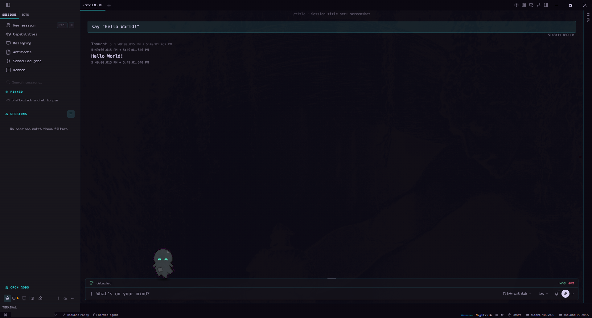
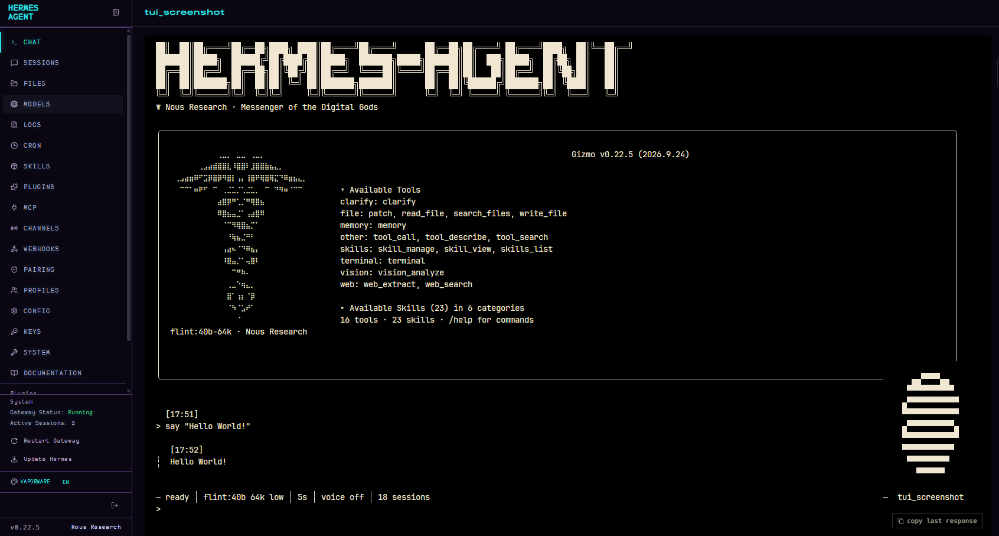
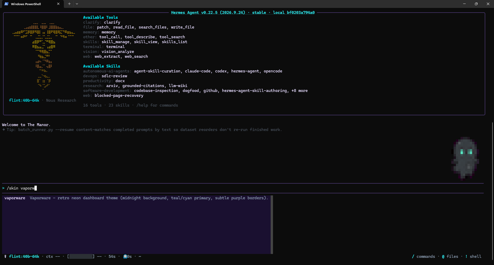

# Vaporware for Hermes

80s retro vaporwave theme for Hermes Agent: the web dashboard, Hermes Desktop and
the TUI. Made for The Manor / Gizmo by dstinebaugh.

Midnight background, hot pink primary, cyan accent, neon green / yellow / red
status colors. monofur for the interface, Hack for chat, tool output, terminal and code.

**Desktop**



**Dashboard (web UI)**



**TUI**



## What is in here

| Path | What |
| --- | --- |
| `plugin.yaml`, `__init__.py`, `desktop/plugin.js` | Hermes Desktop theme plugin (fonts embedded as base64 WOFF2) |
| `dashboard/vaporware.yaml` | Web dashboard theme (fonts embedded via `typography.fontUrl`) |
| `skins/vaporware.yaml` | TUI / CLI skin (colors and branding) |
| `fonts/hack/` | Hack latin-subset WOFF2 files |
| `LICENSES/`, `THIRD-PARTY.md` | Font licenses and notes |

Fonts are embedded, so nothing is fetched at runtime and it works offline.

## Install

`<HERMES_HOME>` is your Hermes data folder (`%LOCALAPPDATA%\hermes` on Windows,
`~/.hermes` on Linux and macOS).

### Hermes Desktop

```bash
hermes plugins install dstinebaugh/hermes-vaporware-theme --no-enable
hermes plugins enable vaporware-theme
```

The Desktop half ships switched off: in Desktop open Settings > Plugins > Manage plugins, filter the list to installed plugins only (it is easy to miss among the catalog entries), find Vaporware Theme and turn on its Desktop switch (`hermes plugins enable` only turns on the agent half).

Then in Desktop run **Reload desktop plugins** from the command palette (or restart
the app) and pick **Vaporware** in Settings > Appearance. Selecting the `vaporware`
skin also switches Desktop to the full theme. The right-sidebar terminal font is a
Desktop setting: Settings > Terminal font = `Hack`.

### Web dashboard

Copy `dashboard/vaporware.yaml` to `<HERMES_HOME>/dashboard-themes/`, then pick
Vaporware in the dashboard theme switcher, or set in `config.yaml`:

```yaml
dashboard:
  theme: vaporware
```

Hard-refresh the browser after switching.

### TUI / CLI

Copy `skins/vaporware.yaml` to `<HERMES_HOME>/skins/` and run `/skin vaporware`
(or set `display.skin: vaporware`). Skins cannot carry fonts; set Hack in your
terminal. Windows Terminal, in settings.json under your profile:

```json
"font": { "face": "Hack" }
```

Install Hack from https://github.com/source-foundry/Hack/releases first.

## monofur (optional, not bundled yet)

monofur will be bundled once its author has been contacted. Until then the themes
list `'monofur'` first and fall back to Hack. To use it now, install monofur
locally (for example from https://github.com/chrissimpkins/codeface/tree/master/fonts/monofur)
together with its license text.

## Credits

- Theme: dstinebaugh, for The Manor / Gizmo.
- Structure and font-embedding approach inspired by
  [mykeura/minimalist-themes-for-hermes](https://github.com/mykeura/minimalist-themes-for-hermes) (MIT).
- Hack by Source Foundry. monofur by tobias b koehler. See THIRD-PARTY.md.

## License

MIT for the theme code. Fonts keep their own licenses; see THIRD-PARTY.md and LICENSES/.
